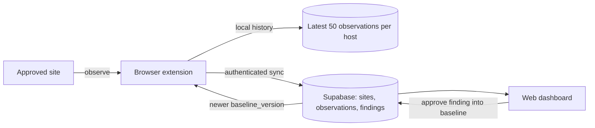

# PageTripwire

**Client-side supply-chain tripwire.** PageTripwire records what a web page actually loads and does in the browser, compares it with an approved baseline, and raises confidence-ranked findings when something unexpected appears: a new third-party script, a changed resource, a form that now posts to another domain.

> Formerly named ScriptSentry. Renamed to avoid confusion with unrelated projects of the same name.

> **Status: research prototype.** PageTripwire is the subject of an MSc Cyber Security dissertation (University of Aberdeen). The current code is a developer-mode detection prototype. It is **not** a blocking control and **not** a Chrome Web Store release. A full re-development runs January to April 2027, and evaluation results will be added to this README when they exist.

---

## Why this exists

Server-side monitoring cannot see what runs in a visitor's browser. Attacks such as web skimming (Magecart-style card theft) work by changing the scripts, requests or form destinations a page uses after it leaves the server. Real-world cases include the 2018 British Airways breach, where a small amount of injected JavaScript sent customer payment data to an attacker-controlled domain.

PageTripwire tests one question: **can an evidence-first, baseline-and-diff monitor running in the browser detect unexpected client-side changes with a useful signal-to-noise ratio, without the ability to block them?**

## How it works



1. The user explicitly approves a site. The extension requests a per-origin optional permission, so nothing is monitored by default.
2. The first observation is reviewed and approved as the **baseline**.
3. Each later observation is compared with the baseline. Differences become **findings** with a confidence ranking.
4. Observations are stored locally and, when signed in, uploaded as **immutable** records.
5. In the dashboard, the user approves, rejects or suppresses findings. Approving a finding into the baseline increments the cloud `baseline_version`, and the extension adopts the newer version before it evaluates its next snapshot.

### What it observes

- Scripts (inline and external) and script requests
- Iframes
- Form actions and destinations
- `fetch` and XHR requests
- Dynamically added elements

## Components

| Component | Purpose | Location |
|---|---|---|
| Browser extension (Manifest V3) | Observes approved sites, keeps local evidence, evaluates changes, syncs to the backend | `[path or repo link]` |
| Web dashboard (Vite) | Site analysis, finding review, evidence drill-down, exports | `[path or repo link]` |
| Backend | Supabase (Postgres, Auth, Row Level Security) | managed project |

### Browser extension

**What works**

- Manifest V3 extension with per-origin optional permissions
- Script, iframe, form-action, fetch/XHR and script-request inventory
- Dynamic element observation
- Explicit first-baseline approval and confidence-ranked changes
- Local history for the latest 50 observations per host
- Account registration, sign-in and token refresh
- RLS-compatible Supabase writes with visible sync status
- Bidirectional baseline versions: dashboard approvals are adopted before the extension evaluates its next snapshot

**Install (developer mode)**

1. Download or clone this repository.
2. Open `chrome://extensions`.
3. Enable **Developer mode**.
4. Choose **Load unpacked** and select the extension folder.
5. Open a normal HTTP or HTTPS page.
6. Click PageTripwire and choose **Allow and monitor**.
7. Approve the first baseline.
8. Open **Settings** and sign in with the same account as the web dashboard.

**Validate**

```bash
npm test
npm run check
```

### Web dashboard

The dashboard reads real, authenticated observations uploaded by the extension. It uses the same Supabase project and ownership-scoped Row Level Security policies. When no observations exist it shows an onboarding state; it contains no demonstration security events.

**Features**

- Public landing page at `/`
- Authenticated monitoring console at `/dashboard`
- Setup and security guidance at `/docs`
- Account and integration settings at `/settings`
- Email/password registration and sign-in, plus magic-link sign-in
- Per-site overview with real resource and finding metrics
- Searchable, severity-filtered finding review
- Approve-to-baseline, reject and suppress decisions
- Immutable observation history with resource-level inspection
- Inventory CSV export and printable evidence report
- Responsive empty, loading and error states

**Local development**

```bash
npm install
npm run dev
```

Required build variables:

```
VITE_SUPABASE_URL
VITE_SUPABASE_PUBLISHABLE_KEY
```

**Validate**

```bash
npm run check
npm test
npm run build
```

## Security design

- **No secrets in the client.** The extension and dashboard use only the public Supabase publishable key. No secret or service-role key is ever shipped.
- **Authorisation lives in the database.** Ownership-based Row Level Security is the authorisation boundary. Each user can query only their own rows.
- **Immutable evidence.** Each snapshot is inserted as an immutable observation, followed by its findings. Decisions on findings change review state, not the recorded observation.
- **Consent per origin.** Monitoring requires an explicit per-origin permission grant by the user.
- **Baseline conflicts.** A newer cloud baseline wins; a newer, explicitly approved local baseline is uploaded.

## Limitations

- **Detection and evidence only.** PageTripwire does not block anything. Manifest V3 limits programmatic request blocking, and v1 is deliberately positioned as monitoring.
- **Client-side view only.** It cannot see server-side compromise except through its visible effect in the browser.
- **Baseline quality matters.** A baseline approved from an already-compromised page will treat the compromise as normal.
- **Noise from legitimate change.** Marketing tags, A/B tests and consent tools change often; finding confidence ranking and suppression exist to manage this, and measuring the result is part of the research.
- **Not a compliance tool.** The inventory export and evidence report are aids for review. They do not demonstrate compliance with any standard.
- **Prototype scope.** Developer-mode Chrome only. Not a Chrome Web Store release.

## Research context

| | |
|---|---|
| **Programme** | MSc Cyber Security, University of Aberdeen |
| **Research question** | `[state your dissertation question here]` |
| **Compared approaches** | Content Security Policy and CSP reporting, Subresource Integrity, `[other tools you will compare]` |
| **Evaluation plan** | `[sites tested, injected-change scenarios, metrics such as detection rate and false-positive rate]` |
| **Re-development window** | January to April 2027 |
| **Results** | To be added after evaluation |

## Roadmap

- [x] Developer-mode prototype: observation, baselining, local history, cloud sync, dashboard review
- [ ] Re-development for dissertation (Jan to Apr 2027)
- [ ] Evaluation against realistic injected-change scenarios
- [ ] Published results and write-up

## Contributing and security reports

This is a research project. Issues and discussion are welcome. For security issues in PageTripwire itself, contact `[email address]` rather than opening a public issue.

## Licence

`[choose a licence, e.g. MIT or Apache-2.0]`

## Author

Aniket Badole: [aniketbadole.com](https://aniketbadole.com) · [github.com/aniketbadole](https://github.com/aniketbadole)
